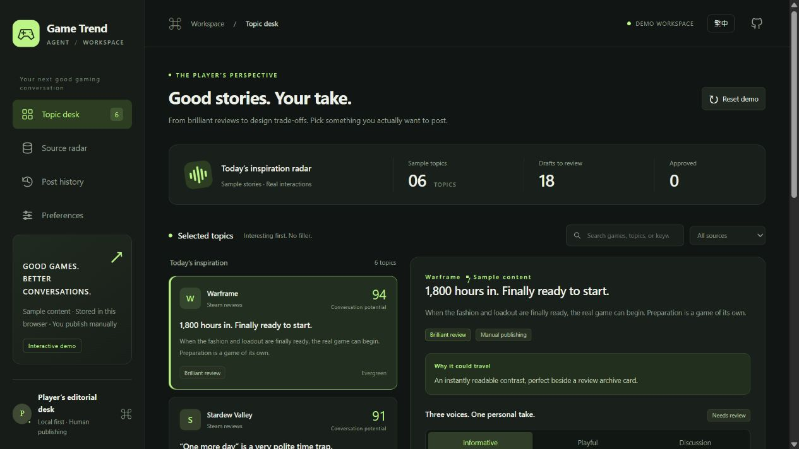

# Game Trend Agent · Web

**繁體中文 / English**

一個給雜食玩家的雙語選題工作台：從有趣評論找到切口，對照來源，挑選資訊、吐槽或討論草稿，再由自己決定是否發布。

A bilingual editorial workspace for curious gamers: find an angle in player comments, review the source, compare three draft styles, and choose what to publish yourself.

## 線上演示 / Live demo

[開啟工作台 / Open workspace](https://fufufuwa.github.io/game-trend-agent-web/)



這是獨立的純前端演示。所有話題、計數及草稿都是示例，操作僅儲存在目前瀏覽器；不會連線至本機 Game Trend Agent、不會執行採集或呼叫模型，也不會向 X 發布。

This is a standalone frontend demo. Topics, counters, and drafts are examples; interactions are saved only in your current browser. It does not connect to a local Game Trend Agent, collect live sources, call a model, or publish to X.

## 功能 / Features

- 繁中與英文切換，桌面及手機皆可使用。 / Traditional Chinese and English, with a responsive layout.
- 搜尋、來源篩選、話題詳情與證據區。 / Search, source filters, topic details, and source context.
- 資訊、吐槽與討論三種草稿。 / Informational, playful, and discussion drafts.
- 開始編輯即保護該示例版本；另建版本不覆蓋人工內容。 / Starting an edit protects that demo version; regeneration appends a separate version.
- 保存、批准、拒絕、複製和手動登記已發快照。 / Save, approve, reject, copy, and manually record a published-text snapshot.
- 來源與偏好設定頁，以及僅清除此演示資料的重置。 / Sources and preferences views, with a reset limited to this demo's own data.

前端演示的編輯鎖與字數提示不構成伺服器端保證。正式版本的資料庫保護、`twitter-text` 精確校驗、採集、模型調用和排程由現有 Python 工程處理；本倉庫不含該後端及其資料。

The demo's edit locks and character estimate are UI demonstrations. Production database protection, exact `twitter-text` validation, collection, model calls, and scheduling belong to the existing Python project. That backend and its data are not included here.

## 本機預覽 / Local preview

無需安裝套件或建置。 / No packages or build step required.

```powershell
python -m http.server 4173 --bind 127.0.0.1
```

開啟 / Open <http://127.0.0.1:4173/>。僅預覽介面也可直接開啟 `index.html`；剪貼簿等瀏覽器功能請使用本機 HTTP 預覽或 HTTPS 網站。

You can also open `index.html` directly to view the UI. Use localhost or HTTPS for browser features such as the clipboard.

```powershell
node check.mjs
```

執行零依賴的資產及腳本檢查。 / Run the dependency-free asset and script check.

## GitHub Pages

推送至 `main` 後，工作流程會先檢查，再以白名單將前端檔案包裝至 `_site`，發布到 GitHub Pages。倉庫 Pages 的來源需設為 **GitHub Actions**。

Pushing to `main` runs the check and packages an explicit list of frontend files into `_site` for GitHub Pages. Set the repository's Pages source to **GitHub Actions**.

參考 / Reference: [GitHub Pages custom workflows](https://docs.github.com/en/pages/getting-started-with-github-pages/using-custom-workflows-with-github-pages).
